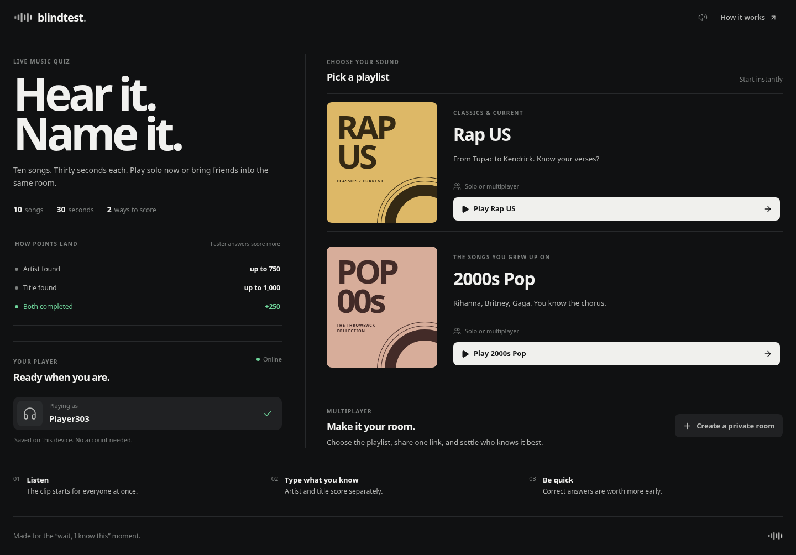
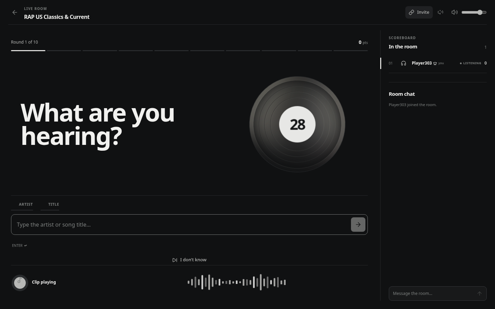
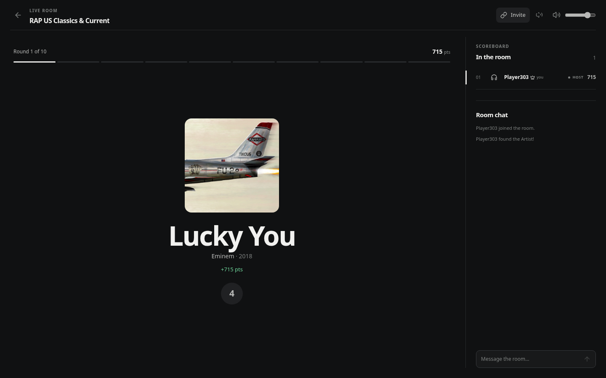

# 🎵 Blindtest Live — Real-Time Multiplayer Music Game

A modern real-time multiplayer music blindtest web application powered by WebSockets, typo-tolerant fuzzy matching (Levenshtein distance), and a sleek charcoal dark theme (`#0d0d10`) with purple/mauve accents.

---

## 📸 Screenshots

| Lobby & Room Selection | Active Gameplay & Live Guesses |
| :---: | :---: |
|  |  |

<p align="center">
  <b>Track Reveal & Leaderboard</b><br/>
  
</p>

---

## ⚡ Key Features

1. **Real-Time Multiplayer (Socket.io):**
   - Ready-to-play rooms (**RAP US**, **POP 2000-2010**, and **EMO & ALT**) plus custom room creation.
   - Instant player, score, and leaderboard synchronization.
   - Live activity chat feed highlighting guesses without spoiling titles or artists to other players.

2. **Streamlined & Automated Game Loop:**
   - **Single 2-second warm-up** at the beginning of the match (no annoying blockers between tracks).
   - **30-second listening rounds** with verified official audio previews.
   - **Fuzzy Validation (Levenshtein Distance):**
     - Tolerates small typos (e.g. *"Brithney Spears"* ➔ *Britney Spears*, *"Kendrik Lamar"* ➔ *Kendrick Lamar*, *"Tupac"* ➔ *2Pac*).
     - Independent matching for Artist, Title, or both in a single submission (*"Artist - Title"*).
     - Combo bonus awarded when both Artist and Title are resolved.
     - Time-decay scoring giving more points to fastest answers.
   - **Fast 4-second Reveal:** Album cover, title, artist, year; immediate progression to next track (hosts can skip ahead).
   - **Skip Option:** "I don't know" preserves already scored points. Rounds finish early if all active players have guessed or skipped.
   - **Smart Anti-Repetition:** 2-game rotation lockout per playlist so you never hear the same tracks in consecutive matches.

3. **Robust Audio & Autoplay Handling:**
   - Seamless handling of browser autoplay policies with an instant unlock prompt if blocked.
   - Volume slider and mute toggle.
   - Live responsive audio equalizer visualization.

---

## 🚀 Quick Start

### 1. Install All Dependencies
From the repository root:
```bash
npm run install:all
```
*(Or install manually in the root, `server/`, and `client/` directories)*

### 2. Run in Development Mode (Client + Server in one command)
```bash
npm run dev
```
- **Frontend:** [http://localhost:5173](http://localhost:5173)
- **Backend WebSocket:** [http://localhost:3001](http://localhost:3001)

### 3. Run Services Separately
- **Server only:**
  ```bash
  npm run server
  ```
- **Client only:**
  ```bash
  npm run client
  ```

---

## 🧪 Automated Tests

Run server test suites validating the game engine, fuzzy logic, chat, and anti-repetition rules:
```bash
npm test --prefix server
```

Build the client for production:
```bash
npm run build --prefix client
```

---

## 📁 Project Structure

```
blindtest/
├── package.json              # Root orchestration scripts (dev / build / install)
├── .env.example              # Environment variables template
├── README.md                 # Project documentation
├── server/                   # Node.js + Express + Socket.io backend
│   ├── package.json
│   ├── src/
│   │   ├── index.js          # Express server & Socket.io gateway
│   │   ├── gameEngine.js     # Rooms, rounds, timers, streaks, and scoring
│   │   ├── fuzzyMatch.js     # String normalization & Levenshtein matching
│   │   └── data/
│   │       └── playlists.js  # RAP US, POP 2000 & EMO ALT track catalogs
│   └── test/                 # Integration, UX flow, and fuzzy matching tests
└── client/                   # React frontend (Vite + Tailwind CSS)
    ├── package.json
    ├── vite.config.js
    ├── tailwind.config.js
    ├── src/
        ├── App.jsx           # Root layout component
        ├── index.css         # Charcoal & mauve design tokens
        ├── context/
        │   └── SocketContext.jsx # Real-time WebSocket connection state
        └── components/
            ├── Lobby.jsx             # Room browser, nickname & avatar picker
            ├── GameRoom.jsx          # Primary active gameplay screen
            ├── AudioPlayer.jsx       # Audio playback engine & autoplay unlocker
            ├── GuessInput.jsx        # Real-time answer submission input
            ├── CountdownOverlay.jsx  # Game start countdown overlay
            ├── RevealCard.jsx        # Track reveal artwork & details
            ├── Leaderboard.jsx       # Real-time rankings & scores
            ├── ChatFeed.jsx          # Live spoiler-free event feed
            └── VolumeControl.jsx     # Volume slider & mute button
```

---

## 🌐 Production Deployment

- **Client (Frontend):** Deploy `client/` to Vercel, Netlify, or Cloudflare Pages. Set `VITE_SERVER_URL` pointing to your deployed WebSocket backend.
- **Server (Backend):** Deploy `server/` to Render, Railway, Fly.io, or VPS. Configure `PORT` (e.g. `3001` or `8080`).

---

## 📄 License

This project is open source and available under the [MIT License](LICENSE).
